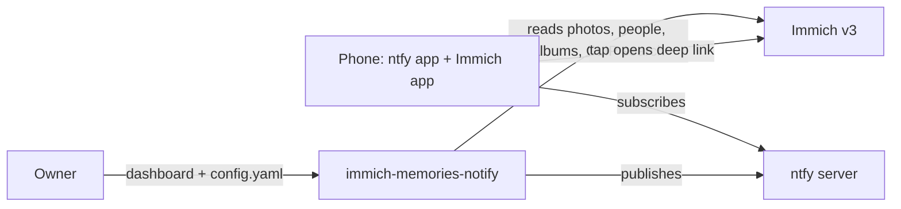
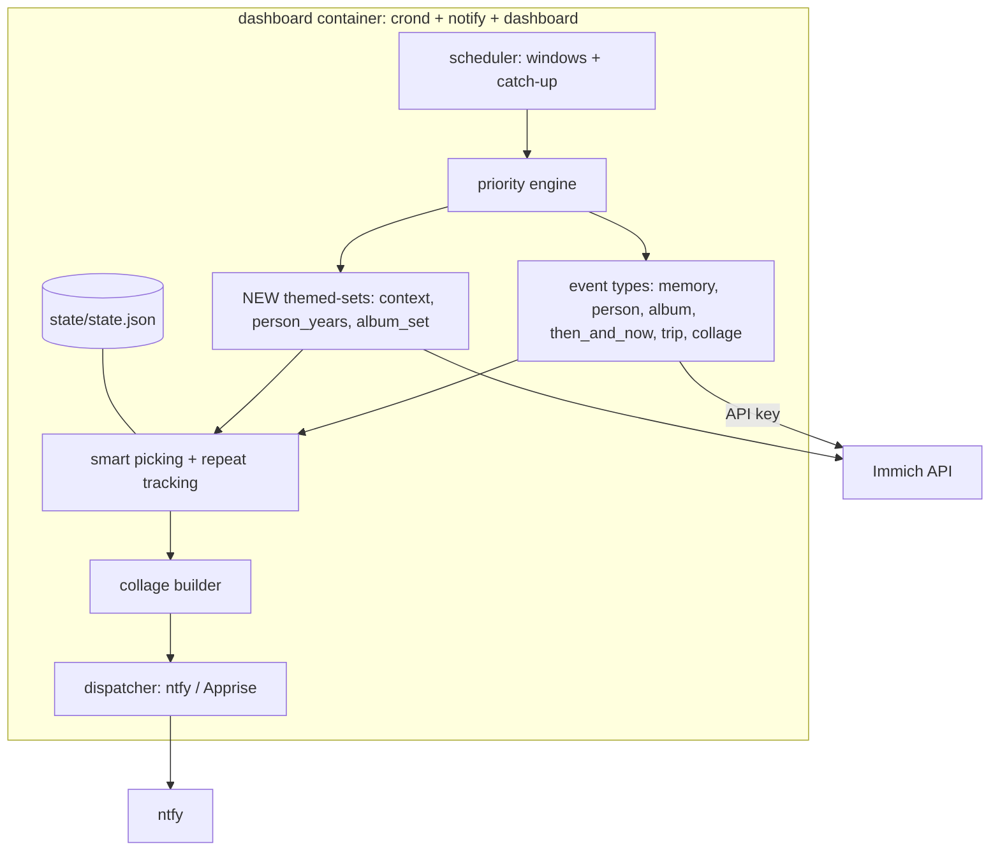

# Architecture (arc42, trimmed)

Personal fork of [ismaildakrory/immich-memories-notify](https://github.com/ismaildakrory/immich-memories-notify) (MIT), based on upstream 3.4.1. Module designs live in [docs/design/](design/).

## 1. Goals

- Daily "memories" push notifications from a self hosted Immich, in the spirit of Google Photos memories.
- Few, well chosen, varied notifications: **one a day, at a random time**, showing a small set of photos (3 to 6), with a long no-repeat period.
- Privacy first: rely on upstream's existing privacy rules; the new event types must not add any new exposure.
- Every local change is tracked in this fork and kept small, so upstream updates stay mergeable.

## 2. Constraints

- One Ubuntu homelab server, Docker, next to Immich (microk8s) and ntfy. Reached only over Tailscale.
- Immich v3 API. Majors can change fields, so calls are covered by tests.
- Only about 0.3% of the library (84 of roughly 25,000 photos) has GPS, and about 84% are WhatsApp files dated by arrival. Selection cannot rely on location or exact capture time.
- Python, upstream layout (`notify/`, `dashboard/`, `tests/`) is kept.

## 3. Context (C4 level 1)

## 4. Solution strategy

- **Build on upstream, do not rewrite.** Upstream 3.4.1 already provides scheduling windows with catch-up, sent-photo tracking (`asset_repeat_days`), screenshot skipping, deep links, collages, then and now, album and person notifications, a dashboard and tests.
- Add one new module, [themed-sets](design/themed-sets.md), for what is missing: a varied single daily notification, context themes (CLIP), and person and album sets of 3 to 6 photos.
- Reuse upstream's collage builder for the 3 to 6 photo sets (ntfy allows one attachment per message).

## 5. Building blocks (C4 level 2)

New blocks are marked NEW. Everything else is upstream.

## 6. Runtime

One run: the window fires at its start, waits a random delay inside the window, picks an event type, gathers candidates, picks photos, builds the notification and records what was sent. Details for the new parts are in the design doc.

## 7. Deployment

`docker compose` in `~/immich-memories-notify` on the server, one container with embedded cron. Secrets in `.env` (git ignored). The personal `config.yaml` values and `state/` are not committed to this fork. Updating the server means `git pull` from this fork and a rebuild.

## 8. Cross-cutting concepts

- **Privacy**: upstream's existing rules (hidden people, app-generated images and screenshots skipped, locked photos not visible to the API key). No new privacy features; a test proves the new event types never use locked or archived photos. No third party calls.
- **Configuration**: tunable in `config.yaml`; secrets only in `.env`.
- **State**: upstream `state/state.json`; deleting it only means photos may repeat early.
- **Testing**: upstream pytest suite plus tests for every new module; privacy tests are written first.
- **Observability**: check that scheduler output reaches the container log (it did not on the old 2.5.2 install).

## 9. Decision log

| Date | Decision | Why | Alternatives rejected |
|---|---|---|---|
| 2026-11-25 | D1: keep a personal fork of the upstream project on GitHub | Changes stay tracked and cannot be lost on the server | Patch the server copy in place (untracked); upstream PRs only (our goals differ, slow) |
| 2026-11-25 | D2: base on upstream 3.4.1 and retire the old local patches | The server ran 2.5.2, 46 commits behind. Upstream already fixed the tap-to-open links, added repeat prevention, screenshot skipping, catch-up and Immich v3 fixes | Keep patching 2.5.2; rewrite from scratch |
| 2026-11-25 | D3: one notification per day in a single window 10:00 to 23:00, with a varied event pick | Five fixed notifications a day was too many; a random time feels spontaneous. Upstream forces window 1 to always send a memory, so variety needs a change | Five fixed windows (previous setup); fixed time |
| 2026-11-25 | D4: 3 to 6 photos per notification, built as one collage image | ntfy allows one attachment per message; 20 photos is too much | One photo only; several messages |
| 2026-11-25 | D5: no new privacy features; keep upstream's rules and add a visibility test | The owner reviewed the existing privacy handling and considers it sufficient | Exclusion album, excluded people and date ranges (rejected as unnecessary) |
| 2026-11-25 | D6: event highlights come from albums and `[Auto]` event albums, not GPS cities | Only 84 photos have GPS, so the upstream trip feature almost never triggers | GPS based trips |
| 2026-11-25 | D7: raise `asset_repeat_days` from 60 to 180 | A photo should return after a long pause, not soon | Keep 60 |

## 10. Risks and technical debt

- Immich major upgrades may change API fields. Mitigation: tests, rerun after each Immich upgrade.
- Notification previews can appear on the phone lock screen. Mitigation: privacy rules; ntfy has no blur option.
- Diverging from upstream makes merging harder. Mitigation: new module, small hooks into upstream files, merge `upstream/main` regularly.
- CLIP search quality varies by query. Weak themes get low weight or are removed in config.

## 11. Glossary

- **Window**: a time range in which one notification is sent.
- **Event type**: the kind of notification (memory, person, album, then and now, trip, collage, and the new context, person_years).
- **Theme**: the rule that produced a set of photos (for example "sunsets").
- **Set**: the 3 to 6 photos shown in one notification.
- **`[Auto]` event album**: an album created by the planned grouping tool from date clusters.
- **ntfy**: self hosted push notification service.
